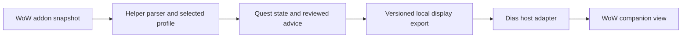

# WoW Helper on Dias

Status: two helper display views implemented, 2026-10-23. Native Dias integration remains proposed. DBM is deferred by operator direction.

## Current direction

Use two selected screens: **Quest log** on one and **Activity cards** on the other. The cards open Quest help, Gear check, Screen adviser, or Journal / Resume in place. Each workflow keeps independent state; Activity cards and Resume switch between the grid and the last workflow. Return to Dias hides the pair while preserving work. See [current controls and verification limits](CHAT.md#quest-and-activity-displays).

This replaces the original single companion-screen trial below. The delivered component is ordinary helper windows, with explicit screen selection and local persistence. It does not add a native Dias route, display-ownership protocol, live telemetry, or healer automation. Synthetic tests and app captures verify navigation and saved states; live touch and coexistence with Dias remain to be checked. The native adapter and other exploratory ideas below are future proposals, not requirements for this increment.

## Earlier integration proposal

Start with a temporary **WoW mode on the Dias companion touch display**: a quest overview beside one selected objective and its pinned advice, with a persistent **Return to Dias** control. Keep the main Dias navigator available. Prove that the two desktop apps can share the companion screen before building a native Dias game view.

Use Dias's screen and interaction patterns, but give game quests their own data model and view. Its development chips describe software work and contribute to project completion; they must not become a player's quest database. Real play data stays in ignored local storage, never in the tracked project board.

This is a proposed integration track alongside the [upgrade plan](UPGRADE_IMPLEMENTATION_PLAN.md). Linked journal and Resume session are delivered. Compact pinned advice is now delivered separately and supplies the saved selections for the full advice-card experience; the Dias display integration remains proposed.

## What we can build on

| Foundation | Current evidence | Consequence |
| --- | --- | --- |
| Quest snapshot | The addon exports quest IDs, objectives, progress, zones, completion flags, and available quests where supported. A real beta snapshot passed the documented checks. | A useful quest mirror is possible now; coverage is not proven for every quest or client. |
| SavedVariables | The addon updates memory during play; the game writes the external snapshot on reload or logout. | The board shows the last saved log, not continuous live progress. |
| Helper advice | Quest research, source conversations, and saved journal evidence already exist. | Reuse those services; do not create a second research agent inside Dias. |
| Desktop windows | Helper supports movable, persistent companion windows. Dias has a native shell with a companion surface. | Try sharing the physical screen before integrating their runtimes. |
| Touch and focus | Dias uses a topmost, nonactivating WebView composition surface. Helper uses ordinary Tk windows. | Another topmost window is not automatically a reliable overlay; focus and window order need a real trial. |
| Dias runtime | The deployed host is ASP.NET Core with a .NET shell; React/WebView and native preview views are separate presentations. | Target the current host for a later adapter, not only the retained TypeScript recovery host. |

See [quest behavior and verification](QUESTS.md), [companion windows](CHAT.md), and [journal and pinned-advice contracts](UPGRADE_IMPLEMENTATION_PLAN.md).

## The first useful screen

At a 1280 × 800 touch viewport, use a short top bar and two columns. Keep the selected objective readable while browsing the quest list.

| Quest overview | Selected quest and advice |
| --- | --- |
| Edition/profile selector and snapshot age | Quest title, zone, and objective progress |
| Working on: active objectives | One reviewed next step, kept visible |
| Ready to turn in: snapshot says complete | Source, source time, and any uncertainty |
| Nearby pickups: separate, when supported | Open conversation, Request advice, Pin step |
| Read saved snapshot | Persistent Return to Dias |

These are proposed controls, not existing UI. A compact display should show fewer complete cards rather than shrink text to fit every quest. Touch targets should be at least 44 logical pixels, with keyboard access and visible focus.

- Selecting a card opens its saved objectives and advice without sending a request. **Request advice** is an explicit action that identifies the quest, edition, selected session, and snapshot being sent.
- **Open conversation** navigates to the source and preserves drafts. It does not rerun the quest's opening prompt. **Pin step** freezes the selected text and its evidence; later replies do not silently replace it.
- **Read saved snapshot** rereads the local export. Explain when the player must reload in WoW to produce newer data. It never sends a reload command to the game.
- Display “Saved 12 minutes ago” separately from “Advice saved 5 minutes ago.” Rereading an unchanged file must not make the game data appear newer. Reuse the helper's stale threshold and show missing or invalid data explicitly.
- A quest absent from a later snapshot is not automatically completed: it could have been abandoned or omitted. Use explicit completion evidence when available; otherwise show that its state is unknown. Objective completion means ready to turn in, not necessarily turned in.
- Keep available pickups distinct from accepted quests. Missing support means “Unavailable for this snapshot,” not “No quests nearby.”
- Use an explicitly selected local profile and edition. Never switch characters because another file happens to be newer. Display labels can be private local aliases; no account identifiers are needed on the screen.

## Sharing the physical display first

The first experiment is a reversible desktop arrangement, not an in-game overlay. Open the helper on the explicitly chosen companion monitor and make returning to Dias a single visible action. Leave the navigator and the shared Dias host running.

Both apps can be topmost. Test whether ordinary explicit window placement is sufficient; do not assume it from either app's settings. If a reliable transition requires Dias cooperation, design a narrow display-mode handoff in a separate Dias change. Do not add a periodic raise loop or close the shared host to keep the helper visible.

Define the handoff before calling this usable:

1. Enter WoW mode only through an explicit operator action. Remember the companion's prior view, Follow/Pin selection, tab, and window arrangement.
2. Keep Return to Dias available even when advice is loading or a source session is missing. Exiting hides the temporary helper view and restores the prior display state without sending requests.
3. Verify touch, mouse, keyboard, DPI scaling, and window order with both apps running. Ordinary Tk interaction may take keyboard focus; do not promise Dias's nonactivating behavior for the helper. Text entry is an explicit focus transition, and returning to the game remains the player's action.
4. If the selected monitor disappears, stop the temporary takeover and provide recovery on an available display. Do not silently cover the game monitor. Restarting either app must leave a usable exit and must not trigger research or game input.
5. Test with synthetic content first. Capture only synthetic app views if retaining public visual evidence.

## A native Dias game view later

Keep one owner for each responsibility:

The helper owns parsing, edition selection, quest ordering, source evidence, and agent conversations. Dias owns its display mode, monitor identity, rendering, and focus behavior. A future adapter consumes a bounded, read-only display export; it does not import helper source code, inspect provider session files, or open another application's database.

Start with an atomically replaced local JSON snapshot in ignored runtime storage. A proposed contract such as `wow-helper.dias/v1` should carry:

| Field group | Required meaning |
| --- | --- |
| Version and revision | Supported format, monotonically changing publication revision, and producer instance identity for restart detection. |
| Context | Opaque local profile ID, edition, client/build information when known, and optional local display label. |
| Freshness | Game snapshot time, helper import time, publication time, and explicit ready/stale/unavailable/error state. |
| Quest identity | Profile + edition + quest ID. Missing IDs get snapshot-local keys and are not silently joined across snapshots. |
| Quest state | Title, zone, objectives, progress, completion evidence, and separate available-pickup capability/state. |
| Advice | Reviewed selection, its original quest/context revision, source labels/links, advice time, and unresolved gaps. |

Set explicit byte, item-count, and string limits before implementing the producer and consumer. Reject unsupported versions and invalid payloads; retain the last valid view with a stale/error indication. Treat addon text and agent text as display data, never markup or instructions. Repeated publication of the same revision must not create new cards or requests.

Use the existing restricted Lua parser upstream. Only export fields required for the view: no credentials, account folders, raw provider transcripts, or unrestricted file references. Real snapshots, profile mappings, and exported advice remain local and ignored.

Do not use Dias's produced-artifact endpoint as a telemetry bus. Its session-bound, ephemeral results have a different lifecycle. Do not fabricate Taskmaster runs to make game data appear in a project panel. Do not navigate the shell to an arbitrary helper URL: the current shell restricts display navigation, so a native mode requires an explicit route and host integration.

Keep the initial adapter local to the desktop. Dias's LAN/browser surface is a separate exposure decision, not something a new route inherits automatically. Begin with the deployed WebView presentation; decide native-view parity explicitly instead of assuming the React component covers both.

If the native view later offers actions, add a separate narrow local command contract for selecting a quest, opening saved advice, or explicitly requesting research. Validate targets and deduplicate request IDs. Rendering, polling, selecting a tab, reconnecting, and restoring state must send nothing. This integration adds no game-key delivery route.

## Healer support: useful before live telemetry

A first healer view can support preparation: encounter summary, expected dangerous mechanics, a manually reviewed cooldown plan, role assignments, and a short checklist. During a fight it can keep the selected plan visible. Afterward it can hold notes and questions for review.

Label information by what it actually is: guide-based expectation, manually started schedule, last saved snapshot, or observed event. A preparation screen cannot know current party health, remaining mana, actual cooldown availability, or who needs a heal from the existing export. A manual schedule must never look synchronized to the encounter.

This is a useful standalone increment. Live health triage, automatic targeting/casting, and exact future damage calculations are not prerequisites for it.

## Deferred: Deadly Boss Mods

DBM exposes callbacks inside WoW for timer creation, updates, stops, pauses, and resumes. Its documented `DBM_TimerBegin` supplies timer identity, duration, spell information, variance information, and whether the bar is enabled; `DBM_TimerStart` is deprecated. Use stable IDs for matching and localized labels only for display. Respect disabled bars. See the [DBM callback reference](https://github.com/DeadlyBossMods/DeadlyBossMods/wiki/%5BInfo%5D-DBM-Events) and the [inspected core implementation](https://github.com/DeadlyBossMods/DeadlyBossMods/blob/9f8d53ca24c573bb797a8a4b8d3fe73c2364219d/DBM-Core/DBM-Core.lua).

That establishes an addon-side signal, not a live desktop connection. The present SavedVariables path cannot deliver those callbacks to Dias during a fight. Compatibility of the required DBM package, encounter modules, and callback versions with the selected Classic Forever client is also unverified.

A separate feasibility experiment must answer these questions in order:

1. **Does this client expose the required events?** In a supported addon environment, record a bounded callback sequence and save it on reload for offline inspection. Verify the exact client, DBM version, and one encounter module. Use synthetic fixtures for public tests.
2. **Can an allowed transport reach the desktop in time?** Prove that independently. An offline callback recording proves parsing, not live delivery. Combat-log tailing might supply observed events if this client supports them, but it does not automatically export arbitrary DBM timer callbacks. Do not assume addon sockets or arbitrary streaming file writes exist.
3. **Can a timeline remain truthful?** Normalize timer start/update/stop/pause/resume, pull/encounter lifecycle, wipe, and restart. A pull countdown alone is not authoritative encounter start. Measure clock offset, delivery age, lost events, resynchronization, and time ranges for variable mechanics.
4. **Is it useful in one encounter?** Before testing, choose a maximum event-age threshold relative to the cue's lead time, then measure end-to-end delay. Suppress expired or uncertain cues instead of showing a late warning as current. Keep an LLM out of the timing path; it can prepare explanations beforehand.

If those checks pass, the first live output should be “raid-wide mechanic expected in this time window,” with source and confidence. Exact damage depends on targets, mitigation, gear, and player actions; a DBM timer alone does not predict future health loss. If live transport remains unavailable, retain the preparation/review view or investigate a supported addon-side presentation separately. Do not solve the gap with memory reading, injection, or network interception.

## Proposed delivery sequence

| Step | Deliverable | Exit evidence |
| --- | --- | --- |
| 1. Display trial | Synthetic quest and advice layout on the Dias companion surface, with explicit enter/return behavior. | Both apps coexist; touch/focus and monitor-loss cases work; Dias state is restored; no repeated raising or requests. |
| 2. Useful quest mirror | Selected-profile saved quest log plus reviewed advice cards, reusing compact pinned advice when delivered. | Stale/missing snapshots, changed profiles, missing quest IDs, unsupported pickups, and frozen advice associations behave correctly. |
| 3. Native Dias mode | Versioned helper export, current-host adapter, and a dedicated game view. | Contract rejection/recovery, restart, bounded data, local-only access, and explicit action deduplication are tested. |
| 4. Healer preparation | Encounter notes, reviewed cooldown plan, and post-fight notes. | Clearly distinguishes plans from observations and never claims live party state. |
| 5. DBM feasibility | One-client, one-encounter event and transport report. | Proven callbacks, measured delivery, lifecycle handling, and an explicit go/no-go for live mechanics cues. |

Steps 4 and 5 are optional follow-on work. Step 1 can begin with synthetic advice while compact pinned advice is being completed. Successful screen sharing need not wait for a native adapter; native integration need not wait for DBM.

**Current implementation chip:** “Use separate quest and resumable activity displays.” The earlier single-screen trial was replaced by the operator's two-screen direction. Next integration verification should check the delivered pair alongside Dias on the actual touch displays. DBM stays deferred; do not start its feasibility experiment as a continuation of this work.

## Verification and research boundaries

This plan was checked against the helper's quest parser, addon export, journal behavior, and upgrade plan; and against Dias's chip-board package, native platform documentation, companion results contract, and shell window behavior. Dias was inspected at revision `66067e1`. DBM core was inspected at revision `9f8d53ca24c573bb797a8a4b8d3fe73c2364219d`; its callback documentation can change independently.

The original planning session changed documentation and the development board only. The subsequent two-display increment is described above and in Chat. Native display handoff, live DBM transport, edition-specific DBM support, and healer usefulness remain unverified.
